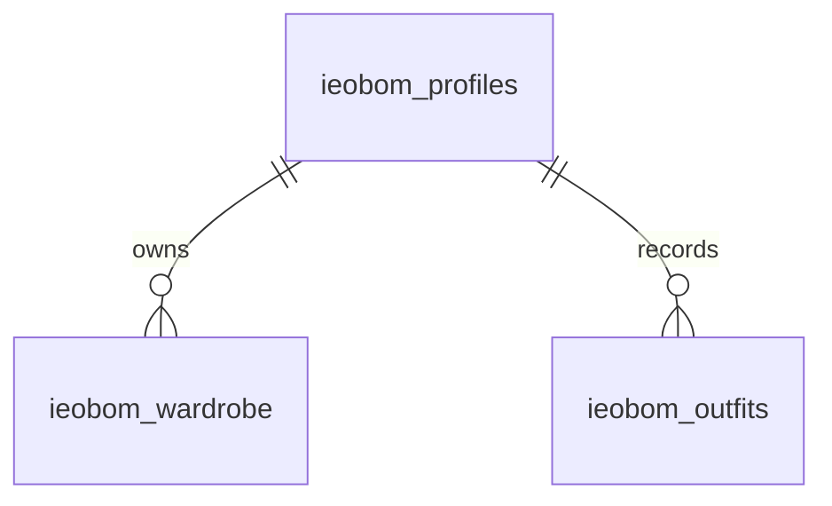

# 입어봄 · 표 설계

모든 행은 수업용 가상 데이터이며 공개 읽기 대상입니다.

| 표 | 주요 열 | 최초 행 수 | 관계 |
|---|---|---:|---|
| ieobom_profiles | id, style, colors, avoid, comfort, goal, remaining, monthly_limit, as_of, period_label | 1 | 부모 |
| ieobom_wardrobe | id, profile_id, name, category, color, swatch | 12 | profile_id → ieobom_profiles.id |
| ieobom_outfits | id, profile_id, title, description, occasion, worn_on, status, thumbnail, reason, tip, rating | 20 | profile_id → ieobom_profiles.id |

프로필 1개에 옷 여러 벌, 프로필 1개에 코디 기록 여러 개가 연결되는 1:N 관계 두 개입니다. 모든 표의 id는 중복되지 않는 문자형 기본키이며, 자식 표의 profile_id는 외래키입니다. 기존 옷 ID w01–w12와 기록 ID look-001–look-005를 유지했습니다.

의류는 상의·하의·아우터·신발·가방만 허용합니다. 기록 상태는 저장됨·착용 완료·피드백 대기, 평점은 0–5를 허용합니다. 0은 아직 평가하지 않음입니다. FK와 CHECK, NOT NULL 제약으로 형식을 제한합니다. 관계 열과 날짜에 인덱스를 둡니다.

RLS는 3개 표 모두 켭니다. anon·authenticated에는 SELECT 권한과 읽기 정책만 주고, INSERT·UPDATE·DELETE 등 공개 쓰기 권한을 회수합니다. service_role은 서버에서만 사용합니다. 읽기 정책이 전체 행을 허용하므로 실제 사용자 비공개 정보를 넣지 않습니다.

서버 읽기 흐름: /api/dashboard → Supabase의 세 표 → 기존 JSON 구조로 변환. 오류·시간 초과·설정 누락이면 data/dashboard.json으로 대체합니다. 출처는 x-data-source 헤더(db/mock)이며, mode 필드는 가상 데이터 표시용으로 유지합니다.

다음 주 챗봇 질문 예: “데이트용으로 저장한 조합은?”, “베이지 팬츠를 활용한 기록은?”, “편안함의 기준은?” 현재는 설명문을 근거로 답할 수 있는 샘플을 제공합니다. 의류 ID별 정밀 검색이 필요해지면 코디-의류 연결 표를 추가하는 확장이 필요합니다.
